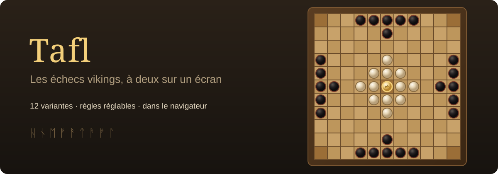

  

<h1 align="center">Tafl</h1>

  Les échecs vikings, à deux sur le même écran : un roi et sa garde contre une armée deux fois plus nombreuse. 
  Douze variantes historiques, toutes les règles réglables, directement dans le navigateur.

  
  
  
  
  
  

par <a href="https://github.com/williamloree">William Loree</a>

  

## Jouer

| | |
|---|---|
| **En ligne** | [williamloree.github.io/Tafl](https://williamloree.github.io/Tafl/) |
| **Hors ligne** | télécharger `index.html` et l'ouvrir dans un navigateur |
| **Installation** | aucune : ni serveur, ni compte, ni dépendance |

## Le principe

Le tafl est la famille de jeux de plateau des peuples germaniques et celtiques, jouée en Scandinavie dès l'âge du fer puis à l'époque viking, avant que les échecs ne la remplacent. C'est un jeu **asymétrique** : les deux camps n'ont ni les mêmes forces ni le même but.

| Camp | But |
|---|---|
| **Défenseurs** (le roi et sa garde, au centre) | amener le **roi** dans un angle du plateau, ou sur un bord selon la variante |
| **Attaquants** (deux fois plus nombreux, sur les bords) | **capturer le roi** en l'encerclant |

| Règle | |
|---|---|
| **Déplacement** | toutes les pièces glissent en ligne droite, d'autant de cases que voulu, comme la tour aux échecs |
| **Capture** | une pièce prise en tenaille entre deux ennemis, ou entre un ennemi et une case hostile, est retirée |
| **Sécurité** | se placer soi-même entre deux ennemis ne fait pas prendre la pièce |
| **Trône** | la case centrale est réservée au roi |
| **Blocage** | un camp qui ne peut plus bouger perd la partie |

## Les variantes

| Variante | Origine | Plateau | Forces | Fuite du roi |
|---|---|---|---|---|
| **Hnefatafl**, règles Wikipédia | Scandinavie | 11×11 | 24 contre 12 + roi | angles |
| **Hnefatafl**, Copenhague | règles de tournoi | 11×11 | 24 contre 12 + roi | angles |
| **Hnefatafl**, Fetlar | Shetland, 2008 | 11×11 | 24 contre 12 + roi | angles |
| **Hnefatafl** | Scandinavie | 13×13 | 24 contre 12 + roi | angles |
| **Tablut** | Laponie, noté par Linné en 1732 | 9×9 | 16 contre 8 + roi | bords |
| **Tawl-bwrdd** | Pays de Galles, 1587 | 11×11 | 24 contre 12 + roi | bords |
| **Brandubh** | Irlande | 7×7 | 8 contre 4 + roi | angles |
| **Ard-Rí** | Écosse | 7×7 | 16 contre 8 + roi | angles |
| **Alea evangelii** | Angleterre anglo-saxonne | 19×19 | 48 contre 24 + roi | angles |
| **Gwyddbwyll** | monde brittonique, reconstitution | 9×9 | 16 contre 8 + roi | angles |
| **Fidchell** | Irlande, reconstitution | 7×7 | 16 contre 8 + roi | bords |
| **Halatafl** | Islande, XIVᵉ siècle | croix de 33 cases | 2 renards contre 20 moutons | — |

Le **halatafl** est un jeu de chasse, ancêtre du jeu du renard et des oies : les renards mangent les moutons en sautant par-dessus, les moutons gagnent en remplissant l'enclos.

## Régler les règles

Les règles exactes de la plupart des tafl anciens sont perdues. Chaque variante démarre avec les règles les plus courantes, et chacune se change avant la partie :

| Option | Choix |
|---|---|
| **Qui commence** | attaquants ou défenseurs |
| **Fuite du roi** | par les angles ou par n'importe quel bord |
| **Capture du roi** | 2 côtés, 4 côtés, ou 2 côtés sauf près du trône |
| **Bord hostile au roi** | trois attaquants suffisent contre un bord, ou roi imprenable au bord |
| **Roi armé** | le roi participe aux captures, ou non |
| **Trône** | traversable ou non, hostile aux défenseurs quand il est vide ou non |
| **Encerclement total** | fait gagner les attaquants, ou sans effet |
| **Triple répétition** | partie nulle, défaite des défenseurs, ou ignorée |
| **Halatafl** | 2 renards et 20 moutons, ou 1 renard et 13 moutons ; prise obligatoire ou non |

## À l'écran

| | |
|---|---|
| **Coups possibles** | un clic sur une pièce affiche les cases où elle peut aller |
| **Dernier coup** | surligné sur le plateau |
| **Historique** | noté comme aux échecs (`e1–e4×e5`) |
| **Annuler** | bouton ou `Ctrl+Z`, sans limite |
| **Revanche** | avec les mêmes camps ou en les inversant |
| **Score** | victoires et nulles de la séance, avec le nom des joueurs |
| **Sauvegarde** | la partie en cours reprend après un rechargement de la page |
| **Règles** | fiche détaillée de la variante choisie, à jour des options |

## Comment ça marche

| | |
|---|---|
| **Code** | un seul fichier `index.html` : HTML, CSS et JavaScript, sans bibliothèque ni étape de build |
| **Hébergement** | GitHub Pages, depuis la racine de la branche `main` ; chaque push met le jeu en ligne à jour |
| **Données** | partie et score gardés dans le `localStorage` du navigateur, rien n'est envoyé ailleurs |

---

Basé sur la page Wikipédia [Jeux de tafl](https://fr.wikipedia.org/wiki/Jeux_de_tafl) et les reconstitutions courantes ; le gwyddbwyll et le fidchell sont des reconstitutions libres.
